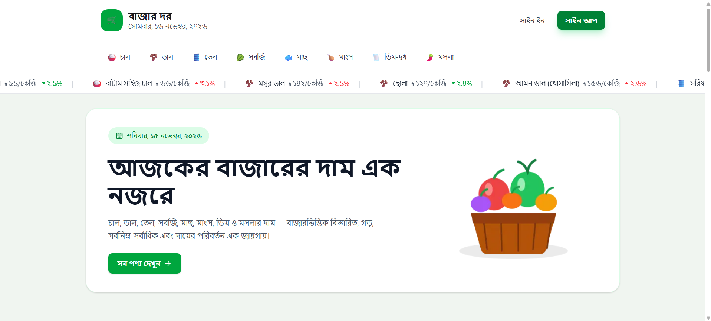

# 🛒 বাজার দর | BazarDor

### Your Daily Guide to Bangladesh's Market Prices 🇧🇩

**বাজার দর (BazarDor)** is a web application that helps users explore daily market prices of essential products in Bangladesh. It provides an easy way to browse products, compare price changes, explore categories, and stay informed about market trends through a clean and user-friendly interface.

🔗 **Live Website:** [https://bazar-dor-seventy-one.vercel.app/](https://bazar-dor-seventy-one.vercel.app/)

---

## ✨ Key Features

1. **📊 Daily Market Prices**  
   Explore the latest available prices of essential products in Bangladesh through an organized and easy-to-understand interface.

2. **📈 Price Change Tracking**  
   See whether product prices have increased, decreased, or remained unchanged compared to previous prices.

3. **🔍 Category-Based Browsing**  
   Browse products by category to find relevant market information quickly and conveniently.

4. **↕️ Product Sorting**  
   Sort products by price from low to high or high to low, making price comparison easier.

5. **🔐 User Authentication & Profile Management**  
   Create an account, sign in using email and password or Google and GitHub, and manage your profile information securely.
---

## 📸 Screenshots

<p align="center">
  
</p>

---

## 🛠️ Technologies Used

| Technology | Purpose |
|---|---|
| Next.js | React framework and application routing |
| React | Building user interfaces |
| TypeScript | Type-safe development |
| Tailwind CSS | Responsive styling |
| HeroUI | UI components |
| Better Auth | Authentication and session management |
| MongoDB | Database |
| Google OAuth | Social authentication |
| GitHub OAuth | Social authentication |
| Vercel | Deployment and hosting |

---

## 📱 Responsive Design

BazarDor is designed to provide a smooth browsing experience across:

- 📱 Mobile devices
- 📲 Tablets
- 💻 Desktop computers

---

## 🚀 Getting Started

### 1. Clone the repository

```bash
git clone YOUR_REPOSITORY_URL
cd bazar-dor
```

### 2. Install dependencies

```bash
npm install
```

### 3. Configure environment variables

Create a `.env.local` file in the project root:

```env
BETTER_AUTH_URL=http://localhost:3000
BETTER_AUTH_SECRET=your_secret
MONGO_URI=your_mongodb_connection_string

GOOGLE_CLIENT_ID=your_google_client_id
GOOGLE_CLIENT_SECRET=your_google_client_secret

GITHUB_CLIENT_ID=your_github_client_id
GITHUB_CLIENT_SECRET=your_github_client_secret
```

### 4. Run the development server

```bash
npm run dev
```

Open [http://localhost:3000](http://localhost:3000) in your browser.

---

## 👨‍💻 Developer

**Abu Raihan Tashin**

- GitHub: [@abrahasin99](https://github.com/abrahasin99)
- LinkedIn: [Abu Raihan Tashin](https://www.linkedin.com/in/abu-raihan-tashin-704a37266/)

---

<p align="center">
  Made with ❤️ in Bangladesh 🇧🇩
</p>
